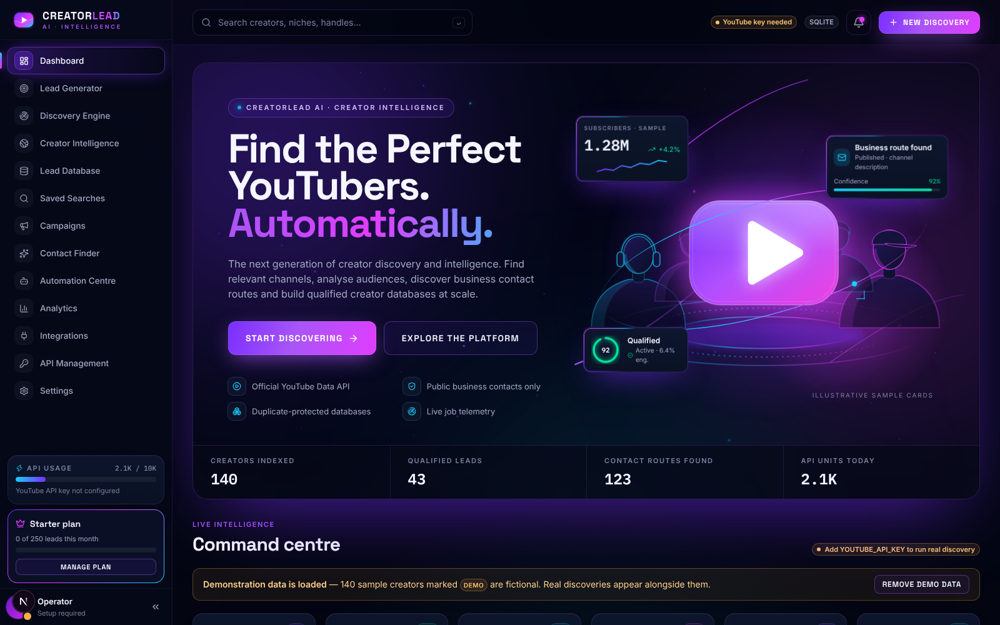

# CreatorLead AI

Creator-intelligence platform: discover YouTube channels through the **official YouTube Data API**, qualify them,
find *publicly published* business-contact routes, and manage the resulting leads in campaigns.



> **Status:** working end to end (see [CHECKLIST.md](CHECKLIST.md) for exactly what is verified and what is not).
> Real discovery needs a YouTube API key; without one every screen still works with clearly-labelled **DEMO** data.

## Architecture

```
Browser ──► Next.js 15 (App Router, TS, Tailwind, Radix/shadcn-style UI, Recharts, Framer Motion, d3-geo map)
              │  /api/* is proxied server-side → the backend URL and every secret stay off the client
              ▼
           FastAPI (REST)  ── background job runner (thread pool) + scheduler ── YouTube Data API v3
              │                       │                                   └─ creators' public sites (SSRF-guarded, robots.txt aware)
              ▼                       └─ n8n webhook on job completion
     PostgreSQL / Supabase (RLS)  ·  SQLite for zero-config local dev  ·  Redis (optional, shared rate limiting)
```

| Path | What |
|---|---|
| `frontend/` | Next.js app: 13 screens, cinematic hero, charts, interactive world map |
| `backend/app/services/discovery.py` | Discovery engine: query expansion → search → dedupe → metadata → filter → enrich → persist |
| `backend/app/services/contacts.py` | Public contact discovery (descriptions, websites, contact pages), SSRF guard, robots.txt, MX check |
| `backend/app/services/youtube.py` | YouTube client with per-call quota accounting and a hard budget check |
| `supabase/migrations/001_init.sql` | Relational schema + row-level security for every table |
| `backend/tests/` | 28 pytest tests (mocked YouTube + websites), also run against real PostgreSQL |

## Quick start (local, no accounts needed)

```bash
# 1. Backend  (Python 3.11+)
cd backend && python -m venv .venv && . .venv/bin/activate
pip install -r requirements.txt
cp .env.example .env            # add YOUTUBE_API_KEY when you have one
uvicorn app.main:app --reload --port 8000

# 2. Frontend  (Node 20+)
cd ../frontend && npm install
cp .env.example .env.local
npm run dev                      # http://localhost:3000
```

Open http://localhost:3000 → **Dashboard → Load demo data** to explore everything immediately.
Add `YOUTUBE_API_KEY` to `backend/.env` and restart to run real discovery from **Lead Generator**.

### Getting a YouTube API key
Google Cloud Console → create a project → enable **YouTube Data API v3** → Credentials → *Create API key*
(restrict it to that API). Default quota is 10,000 units/day. A channel search page costs **100 units**, channel/video
lookups 1 unit each; the engine tracks this per day and stops at your configured budget.

### Testing without a key
```bash
cd backend
uvicorn tests.fake_youtube_server:app --port 8765 &      # local stand-in for the YouTube API
YOUTUBE_API_KEY=fake YOUTUBE_API_BASE=http://127.0.0.1:8765/youtube/v3 uvicorn app.main:app --port 8000
```

## Configuration

See `backend/.env.example` and `frontend/.env.example`. Highlights:

| Variable | Purpose |
|---|---|
| `YOUTUBE_API_KEY` | Server-side only. Never sent to the browser. |
| `DATABASE_URL` | SQLite (default) or Supabase Postgres (`postgresql+psycopg://…`). |
| `AUTH_MODE` | `dev` (single local user) or `supabase` (JWT required; API keys also accepted). |
| `SUPABASE_JWT_SECRET` | Verifies Supabase access tokens. |
| `REDIS_URL` | Shares rate-limit counters between API workers (falls back to in-process). |
| `N8N_WEBHOOK_URL` | Default webhook; each user can set their own in **Integrations**. |
| `BACKEND_URL` (frontend) | Proxy target. **Read at build time.** |

## Deploying

**Supabase + any container host**
1. Create a Supabase project, run `supabase/migrations/001_init.sql` in the SQL editor.
2. Backend: set `DATABASE_URL`, `YOUTUBE_API_KEY`, `AUTH_MODE=supabase`, `SUPABASE_JWT_SECRET`; run the `backend/Dockerfile` image.
3. Frontend: build `frontend/Dockerfile` with `--build-arg BACKEND_URL=https://<backend-host>` plus the two `NEXT_PUBLIC_SUPABASE_*` args.
4. Put both behind HTTPS. Keep the backend private to the frontend if you don't need direct API access.

`docker compose up --build` wires frontend + backend + Redis locally (**the Dockerfiles and compose file have not been
built in CI/this environment** — Docker was unavailable; the Next.js standalone output they rely on was verified directly).

The backend runs the job runner and scheduler **in-process**: run a single API instance, or move `jobs.submit` onto a
queue (RQ/Celery over Redis) before running several replicas — otherwise each replica would also fire scheduled searches.

## Product notes (read before using the data)

* **Only public information.** Emails come from channel descriptions, the creator's own website and its public contact page
  (robots.txt respected, private/internal addresses blocked). Nothing is guessed, generated or bought.
* **Trust levels are explicit:** *Publicly published* (seen on a public page) · *Unverified* (manual entry / non-email routes) ·
  *Verified deliverable* (reserved for mailbox-level verification — **no provider is integrated, so nothing is ever auto-marked verified**).
  The MX check only proves the domain can receive mail.
* **Compliance:** a public business address is not consent. Follow PECR/UK GDPR, EU GDPR/ePrivacy, CAN-SPAM etc. before outreach.
  CreatorLead organises leads; it does not send email.
* **Creator type** is a name-based heuristic. **Engagement** = (likes + comments) ÷ views over the 10 most recent videos; it is
  empty when YouTube hides the data.
* **Quota:** YouTube bills a `search.list` page at 100 units. Jobs have a per-job cap, plus a daily budget with a reserve.

## Design system

Palette: `#030611` / `#080D1C` / `#0A1224` surfaces, `#792EFF` purple + `#A855F7` violet dominant, `#E13DFF` magenta and
`#16CFFF` cyan for highlights, `#00E5A0` for success, `#F5F6FF` text.

Typography (self-hosted via Fontsource, no runtime Google request): **Space Grotesk** — display + headings · **Inter** — body and
interface labels · **IBM Plex Mono** — numbers and technical readouts. This is the pairing suggested in the brief; it was
**not** produced or validated with fontjoy.com (an interactive web tool that couldn't be operated from this environment).
Check/adjust it there if you want a different pairing — fonts are three CSS imports in `frontend/app/globals.css` and three families in `tailwind.config.ts`.

Motion respects `prefers-reduced-motion` (particles, light trails and orbit dots are removed; transitions shorten to 0).

## Tests

```bash
cd backend && pytest                                   # 28 tests (SQLite)
TEST_DATABASE_URL=postgresql+psycopg://… pytest        # same tests against Postgres built from the migration SQL
cd frontend && npm run typecheck && npm run build
```
A 40-step Playwright end-to-end script was used during development against the fake YouTube server (see CHECKLIST.md).

## Security notes
API keys are SHA-256 hashed at rest and shown once · every query is owner-scoped · RLS on every table · SSRF guard + redirect
re-validation on website fetches · CSV export neutralises formula injection · rate limiting (Redis-backed when configured) ·
the YouTube key is stripped from logs (httpx request logging is disabled) · security headers set in `next.config.mjs`.
No CSP is configured yet (Next.js needs nonces for a strict one).

## Part of a combined platform
CreatorLead AI now ships together with **SendLoom** (email marketing) on one origin — see [`../platform/README.md`](../platform/README.md). The Lead Database has a **Send to SendLoom** action and the sidebar an **Email Marketing** entry; everything else is unchanged.
